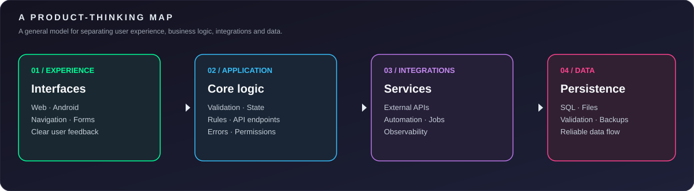

  

  
   
  
  
  

  

## 🚀 The blueprint

I'm a Software Engineering student and developer who enjoys turning ideas into useful, working products. My work and learning span web development, Android apps, scripting and QA automation, applied AI, and creative storytelling.

I care about more than getting code to run: I want to understand the problem, build a clear solution, test the important paths, and keep improving it through feedback.

- 🔭 **Building:** student-focused digital products and practical software projects.
- 🧪 **Exploring:** test automation, API integration, voice-generation workflows, and game development.
- 🧠 **Learning by building:** backend fundamentals, data-driven features, and applied AI workflows.
- 🎬 **Beyond code:** acting, writing, directing, and producing stories with a Kenyan point of view.

  

## 🧩 Selected projects

<table>
  <tr>
    <td width="50%" valign="top">
      <h3>🏘️ CampusHub</h3>
      
A student-focused housing and campus-services platform designed around the needs of university students.

      
<strong>Focus:</strong> web product development, student workflows, marketplace experience.

      
<a href="https://campushub.yreen.co.ke/">Open platform ↗</a> · <a href="https://github.com/J-lahns/CumpusHub_wireframes">Explore wireframes ↗</a>

    </td>
    
<td width="50%" valign="top">
  <h3>🔢 PLAY IT Sudoku</h3>

  
An Android Sudoku game focused on a clean play experience, difficulty selection, pencil notes, hints, and mistake feedback.

  

    
  

  
<strong>Focus:</strong> Kotlin, Jetpack Compose, game state, interaction design, testing.

  
<em>Android project; source link will be added when the repository is publicly available.</em>

</td>

  </tr>
  <tr>
    <td width="50%" valign="top">
      <h3>🎙️ ZURIYA Voice Engine</h3>
      
An audio-storytelling workflow exploring voice generation and narration for African folklore, legends, and historical stories.

      
<strong>Focus:</strong> Python, text-to-speech, repeatable audio generation, creative tooling.

    </td>
    <td width="50%" valign="top">
      <h3>🏀 Afro Ball</h3>
      
A basketball game prototype inspired by African basketball culture, developed with a gameplay-first approach.

      
<strong>Focus:</strong> Godot, GDScript, 3D fundamentals, input, physics, and match logic.

    </td>
  </tr>
</table>

  

## 🧰 Tools I use and explore

  <strong>Languages</strong> 
  

  <strong>Web &amp; application development</strong> 
  

  <strong>Automation, systems &amp; creative technology</strong> 
   
  

  

## 📊 GitHub activity

  
  

  

  

### 🐍 Contribution trail

  <picture>
    <source media="(prefers-color-scheme: dark)" srcset="https://raw.githubusercontent.com/J-lahns/J-lahns/output/github-snake-dark.svg" />
    <source media="(prefers-color-scheme: light)" srcset="https://raw.githubusercontent.com/J-lahns/J-lahns/output/github-snake.svg" />
    
  </picture>

> **If the snake does not appear:** open **Actions → Generate Snake → Run workflow**. The existing workflow publishes the SVGs to the `output` branch. If the run fails, open its logs to identify the problem.

## 🤝 Connect

  
  
  

<em>Building with purpose. Learning in public. Telling stories that stay with you.</em>

  

