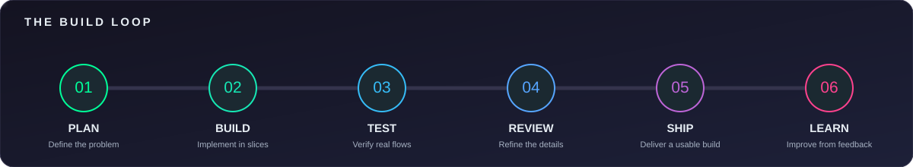

  

  
    
  
  
  

### 🚀 The Blueprint
I am a Software Developer who thrives in the deep end. I don't just write code; I architect **resilient, cloud-native solutions** that can handle real-world traffic. From designing decoupled **microservices** to automating **CI/CD pipelines**, I build end-to-end systems that are production-ready, agile, and scalable.

* 🔭 **Current Mission:** Scaling **Agripool** (Marketplace & Automation) to handle high-volume transactions.
* ☁️ **Cloud Native:** Obsessed with distributed environments, serverless computing, and robust API integrations.
* 🧠 **AI/ML:** Building LLM & RAG architectures, NLP pipelines, and Computer Vision models.
* 🎬 **Fun Fact:** I direct and produce film. I treat system architecture like a movie set—every moving piece needs to execute flawlessly.

 

  

### 💼 Engineering Experience (The Heavy Lifting)

I've leveled up my projects to function exactly how enterprise tech companies operate:

* **Founder & Lead Developer @ Agripool**
  * *Cloud & Scalability:* Deployed, managed, and scaled the platform's backend on **AWS cloud infrastructure** (EC2, S3, RDS) to ensure zero downtime for door-to-door delivery tracking.
  * *Microservices:* Transitioned monolithic backend logic into a **microservices architecture** using Node.js and RESTful APIs for faster, isolated deployments.
* **Cloud & Systems Engineer (Freelance / Contract)**
  * *CI/CD & DevOps:* Built and automated **CI/CD pipelines** using GitHub Actions and Docker, cutting deployment time in half and enforcing strict code review protocols.
  * *Agile Development:* Worked autonomously within remote agile environments, delivering optimized backend services and seamless third-party API integrations for various clients.
* **Lead Developer @ Campus Hub**
  * *Serverless:* Implemented **serverless computing** functions to handle real-time student housing search queries, drastically improving system performance and reducing compute costs.

### 🧰 Tech Stack & Arsenal

**Cloud, DevOps & Backend** (The Engine)  
 

**Databases & AI** (The Brains)  

**Languages, Frontend & Game Dev** (The Interface)  

### 🔥 GitHub Activity & Analytics

  
  

 

  

 

  

 

  <picture>
    <source media="(prefers-color-scheme: dark)" srcset="https://raw.githubusercontent.com/J-lahns/J-lahns/output/github-snake-dark.svg" />
    <source media="(prefers-color-scheme: light)" srcset="https://raw.githubusercontent.com/J-lahns/J-lahns/output/github-snake.svg" />
    
  </picture>

### 🌐 Secure The Connection

  
  
  
  

 

  🎬 That's a wrap, thanks for stopping by.

  

